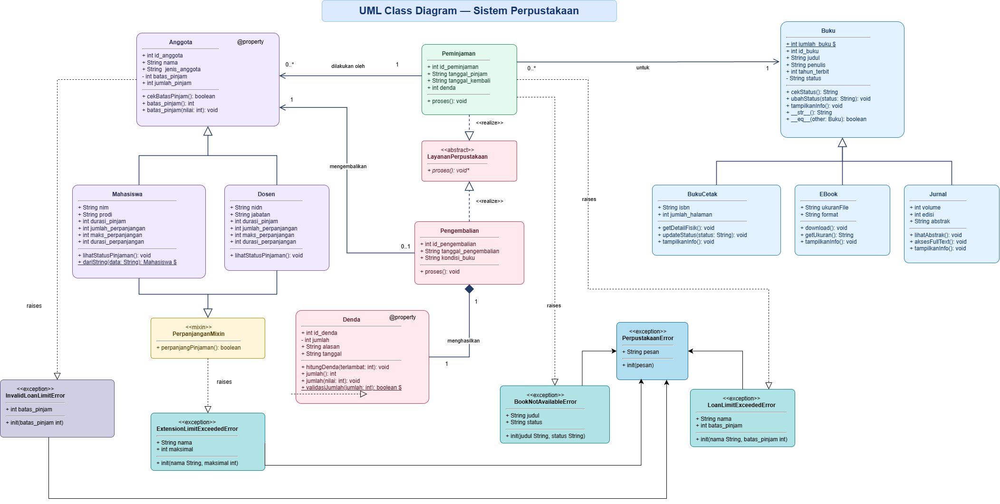

# Nama Kelompok dan Pembagian Tugas

2501010003 NI PUTU DIAN ANANDA PUSVITHA
-> Implementasi Custom Exception (exceptions.py), integrasi program (main.py), pengujian, dan dokumentasi (README.md)

2501010015 NI KADEK ELIVIANA
-> Implementasi validasi pada buku.py, peminjaman.py, dan pengembalian.py, termasuk ketersediaan buku, aturan peminjaman dan class diagram

2501010026 NI KADEK RATNA SINTYA DEWI
-> Implementasi validasi pada anggota.py dan denda.py, termasuk batas peminjaman, batas perpanjangan, dan validasi jumlah denda.

# Sistem Manajemen Perpustakaan Kampus

## 1. Project Overview

Sistem Manajemen Perpustakaan Kampus merupakan aplikasi berbasis Python yang dikembangkan menggunakan konsep Object-Oriented Programming (OOP).

Proyek ini merupakan pengembangan dari sistem perpustakaan yang telah dibuat pada tugas Ujian Tengah Semester (UTS). Pada pengembangan ini, diterapkan Exception Handling untuk menangani kesalahan input dan pelanggaran aturan bisnis agar sistem dapat berjalan dengan lebih terstruktur.

## 2. Features & OOP Concepts

### Fitur Sistem

- Pengelolaan anggota perpustakaan (Mahasiswa dan Dosen).
- Pengelolaan buku (Buku Cetak, EBook, dan Jurnal).
- Peminjaman dan pengembalian buku.
- Perpanjangan masa peminjaman.
- Perhitungan dan validasi denda.
- Validasi aturan bisnis menggunakan Custom Exception.

## 3. Business Rules

Sistem menerapkan aturan bisnis berikut:

1. Batas maksimal peminjaman anggota harus lebih dari 0.
2. Anggota tidak boleh meminjam melebihi batas maksimal peminjaman.
3. Buku hanya dapat dipinjam apabila statusnya tersedia.
4. Perpanjangan peminjaman dibatasi maksimal 2 kali.
5. Jumlah denda tidak boleh bernilai negatif.

## 4. Exception Handling

Exception Handling digunakan untuk menangani kesalahan yang terjadi akibat input tidak valid maupun pelanggaran aturan bisnis.

### Custom Exception Hierarchy

Sistem menggunakan `PerpustakaanError` sebagai base exception yang mewarisi built-in `Exception`.

Custom exception yang dikembangkan:

| Custom Exception              | Keterangan                          |
| ----------------------------- | ----------------------------------- |
| `PerpustakaanError`           | Base exception sistem perpustakaan. |
| `InvalidLoanLimitError`       | Batas peminjaman tidak valid.       |
| `LoanLimitExceededError`      | Anggota melebihi batas peminjaman.  |
| `BookNotAvailableError`       | Buku tidak tersedia untuk dipinjam. |
| `ExtensionLimitExceededError` | Batas perpanjangan terlampaui.      |

### Exception Handling Mechanisms

Implementasi menggunakan:

- `raise` untuk menghasilkan exception ketika aturan bisnis dilanggar.
- `try-except` untuk menangkap dan menangani exception.
- `else` untuk menjalankan kode ketika tidak terjadi exception.
- `finally` untuk menjalankan blok kode setelah proses exception handling.
- `raise ... from` untuk menghubungkan exception dengan penyebab sebelumnya.
- EAFP untuk menangani kemungkinan kesalahan melalui mekanisme exception.

## 5. Project Structure

```text
perpustakaan/
├── anggota.py
├── buku.py
├── denda.py
├── exceptions.py
├── layanan_perpustakaan.py
├── peminjaman.py
├── pengembalian.py
├── main.py
├── README.md
└── docs/
    ├── uml_sistem_perpustakaan_fixed (1).drawio
    └── uml_sistem_perpustakaan_fixed (1).png
```

## 6. How to Run

### Requirements

- Python 3
- Git (untuk melakukan clone repository)

### Clone Repository

```bash
git clone URL_REPOSITORY
```

Masuk ke direktori proyek:

```bash
cd perpustakaan
```

Jalankan program:

```bash
python main.py
```

## 7. Testing Scenarios

Pengujian dilakukan melalui `main.py` untuk memastikan implementasi fitur dan Exception Handling berjalan sesuai aturan bisnis.

### Successful Scenarios

| No. | Skenario                  | Hasil    |
| --- | ------------------------- | -------- |
| 1   | Menampilkan seluruh buku  | Berhasil |
| 2   | Mengakses method subclass | Berhasil |
| 3   | Menggunakan dunder method | Berhasil |
| 4   | Menggunakan classmethod   | Berhasil |
| 5   | Peminjaman buku tersedia  | Berhasil |
| 6   | Pengembalian buku         | Berhasil |
| 7   | Perhitungan denda         | Berhasil |
| 8   | Penggunaan MRO            | Sesuai   |

### Exception Scenarios

| No. | Skenario                     | Hasil                       |
| --- | ---------------------------- | --------------------------- |
| 1   | Batas pinjam tidak valid     | InvalidLoanLimitError       |
| 2   | Melebihi batas peminjaman    | LoanLimitExceededError      |
| 3   | Meminjam buku tidak tersedia | BookNotAvailableError       |
| 4   | Melebihi batas perpanjangan  | ExtensionLimitExceededError |
| 5   | Memasukkan denda negatif     | Validasi ditolak            |

Seluruh skenario yang diuji berhasil dijalankan tanpa menghasilkan traceback yang tidak tertangani.

## 8. Class Diagram

Class diagram berikut menggambarkan struktur class Sistem Manajemen Perpustakaan Kampus, hubungan antarclass, serta hierarki Custom Exception yang diterapkan dalam sistem.


